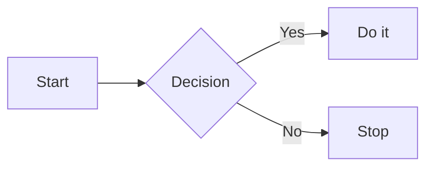

<div align="center">
 
 <h1>Shibui (渋い)</h1>
 <p>A minimalist Hugo theme emphasizing simplicity and refinement</p>
 <p>
  <a href="https://github.com/ntk148v/shibui/blob/master/LICENSE">
   
  </a>
  <a href="https://github.com/ntk148v/shibui/stargazers">
   
  </a>
  <a href="https://gohugo.io">
   
  </a>
 </p>
</div>

Table of contents:

- [Features](#features)
- [Installation](#installation)
  - [As a Git Submodule](#as-a-git-submodule)
  - [Configuration](#configuration)
  - [Page Configuration](#page-configuration)
- [Color Scheme](#color-scheme)
- [Dark Mode](#dark-mode)
- [Syntax Highlighting](#syntax-highlighting)
- [Table of Contents Numbering](#table-of-contents-numbering)
- [Archive Page](#archive-page)
- [Diagrams](#diagrams)
- [Images](#images)
- [Customization](#customization)
  - [CSS Variables](#css-variables)
- [Contributing](#contributing)
- [License](#license)
- [Demo](#demo)
- [Theme Structure](#theme-structure)
  - [Template Organization](#template-organization)
  - [Assets](#assets)
  - [ExampleSite](#examplesite)
- [Updating](#updating)
- [Version Requirements](#version-requirements)
- [Credits](#credits)

|                                                                                                                                  |                                                                                                                                  |
| -------------------------------------------------------------------------------------------------------------------------------- | -------------------------------------------------------------------------------------------------------------------------------- |
|  |  |
|  |  |

[Shibui](https://en.wikipedia.org/wiki/Shibui) (渋い) (adjective), shibumi (渋み) (subjective noun), or shibusa (渋さ) (objective noun) are Japanese words that refer to a particular aesthetic of simple, subtle, and unobtrusive beauty. Like other Japanese aesthetics terms, such as iki and wabi-sabi, shibui can apply to a wide variety of subjects, not just art or fashion.

## Features

- Minimalist design following Shibui (渋い) aesthetics
- Terminal-inspired navigation
- Clean typography with monospace font
- Semantic HTML with proper text styling (bold, italic, blockquotes)
- Paper-like color scheme
- Automatic dark/light theme support
- Nested heading counters
- No JavaScript, except Mermaid on pages that use diagrams
- Highly customizable through CSS variables
- Mobile-responsive layout
- Table of Contents support
- Tags support

## Installation

### As a Git Submodule

```bash
git submodule add https://github.com/ntk148v/shibui.git themes/shibui
git submodule update --init --recursive
```

### Configuration

Add the following to your `config.toml`:

```toml
baseURL = 'http://example.org/'
locale = 'en-us'
title = 'Your Site Title'
theme = "shibui"

[params]
  # Author can be a string or a table with name/email
  author = "Your Name"
  # or:
  # [params.author]
  # name = "Your Name"
  # email = "your.email@example.com"

[menu]
  [[menu.main]]
    name = "Posts"
    url = "/posts/"
    weight = 1
  [[menu.main]]
    name = "About"
    url = "/about/"
    weight = 2
```

### Page Configuration

In the front matter of your content files:

```yaml
---
title: 'Your Post Title'
date: 2023-06-13
tags: ['hugo', 'theme']
---
```

### Theme Parameters

You can configure theme behavior by adding parameters to your site's `config.toml`:

```toml
[params]
  # Author can be a string or a table with name/email
  author = "Your Name"
  # or:
  # [params.author]
  # name = "Your Name"
  # email = "your.email@example.com"

  # Enable/disable comments on posts (default: true)
  comments = true

  # Show estimated reading time on posts (default: true)
  showreadingtime = true

  # Show last modified date on posts (default: false)
  showlastmod = false

  # Social links (optional)
  twitterHandle = "username"
  ogImage = "/images/og-image.jpg"
```

Supported front matter parameters for individual pages:

- `toc` (boolean): Show/hide table of contents (default: true)
- `comments` (boolean): Enable/disable comments for this page (default: site.Params.comments)
- `showreadingtime` (boolean): Override reading time display (default: site.Params.showreadingtime)
- `showlastmod` (boolean): Override last modified date display (default: site.Params.showlastmod)

## Color Scheme

The theme uses a paper-like color palette, use a background primary color as base and then derive the rest of theme colors by shifting lightness (or saturation/hue if needed) relative to that base, so we can easily generate multiple variants (light, dark, high-contrast, etc.). Therefore, you can adjust just base color and keep the same vibe, checkout [#4](https://github.com/ntk148v/shibui/pull/4) for preview.

```css
/* Base theme knobs */
--bg-h: 0;
--bg-s: 0%;
--bg-l: 99%;

/* Background colors */
--color-bg-primary: hsl(var(--bg-h) var(--bg-s) var(--bg-l));
--color-bg-secondary: hsl(var(--bg-h) var(--bg-s) calc(var(--bg-l) - 2%));
--color-border: hsl(var(--bg-h) var(--bg-s) calc(var(--bg-l) - 6%));
--color-selection-bg: hsl(var(--bg-h) var(--bg-s) calc(var(--bg-l) - 13%));

/* Text colors with WCAG-friendly contrast */
/* Primary: ensures near-black on light bg and near-white on dark bg */
--color-text-primary: hsl(
  var(--bg-h) var(--bg-s) clamp(8%, calc(100% - var(--bg-l)), 92%)
);

/* Muted: softer but still >4.5:1 contrast */
--color-text-muted: hsl(
  var(--bg-h) var(--bg-s) clamp(30%, calc(85% - var(--bg-l)), 75%)
);

/* Code text: slightly brighter than muted */
--color-text-code: hsl(
  var(--bg-h) var(--bg-s) clamp(20%, calc(90% - var(--bg-l)), 85%)
);
```

## Dark Mode

The theme follows the OS preference via `prefers-color-scheme`. In dark mode the base lightness (`--bg-l`) is set to `12%`; in light mode it defaults to `99%`.

To force one scheme regardless of the OS, override the knobs in your site's `assets/css/custom.css`. A `:root` rule there overrides both light and dark modes:

```css
:root {
  --bg-l: 12%; /* always dark */
}
```

The safe `--bg-l` range is ≤ 25% (dark) or ≥ 85% (light). Values in between can break the contrast of the derived text colors.

## Syntax Highlighting

The theme ships with minimal monochrome syntax colours for class-based Chroma output. Set in your `config.toml`:

```toml
[markup.highlight]
  noClasses = false
```

With `noClasses = false`, Chroma emits `<span class="k">…</span>` etc. and the theme styles them: keywords are bold, comments are italic and muted, strings use the primary text colour.

With `noClasses = true`, Chroma emits inline `style="…"` colours and the theme's rules do not apply.

## Table of Contents Numbering

The table of contents is numbered automatically via CSS counters. To enable ordered numbering, set in your `config.toml`:

```toml
[markup.tableOfContents]
  ordered = true
```

## Archive Page

Create a page with `layout: archive` to render a year/month-grouped list of posts from the `posts` section:

```yaml
---
title: Archive
layout: archive
---
```

## Diagrams

Use a `mermaid` fenced code block to embed a diagram. The Mermaid script is loaded only on pages that contain at least one `mermaid` block (pinned to a specific version):

````markdown

````

## Images

When an image has a title in its Markdown syntax, the title becomes a `<figcaption>`:

```markdown

```

Images without a title render as a bare `` (no `<figure>` wrapper).

## Customization

### CSS Variables

Create an `assets/css/custom.css` file in your site. It replaces the theme's (empty) `custom.css` and is bundled after `main.css` into one stylesheet, so your rules override the theme's.

For example, to force a dark theme, just adjust the base color:

```css
:root {
  /* Base theme knobs */
  --bg-h: 0;
  --bg-s: 0%;
  --bg-l: 12%;
}
```

## Contributing

Contributions are welcome! Primary goals are:

- Maintain minimalist design principles
- Keep it simple and efficient
- Avoid JavaScript when CSS can solve the problem
- Follow Shibui (渋い) aesthetics

## License

MIT

## Demo

Visit the [demo site](https://ntk148v.github.io/shibui) to see the theme in action.

## Theme Structure

```
shibui/
├── archetypes/          # Content template files
├── assets/
│   ├── css/            # Theme CSS files
│   └── favicon_io/     # Favicon manifest
├── layouts/            # Template files
│   ├── _default/       # Default templates
│   ├── _partials/      # Reusable template parts
│   └── index.html      # Homepage template
├── static/             # Static assets
└── exampleSite/        # Example site for reference
```

### Template Organization

- `layouts/_default/baseof.html`: Base template with common layout
- `layouts/_default/single.html`: Template for individual pages
- `layouts/_default/list.html`: Template for section pages
- `layouts/_default/archive.html`: Template for the archive page (`layout: archive`)
- `layouts/_default/_markup/`: Render hooks for Markdown elements (images, code blocks)
- `layouts/_partials/`: Contains reusable components like header, footer
- `layouts/index.html`: Homepage template

### Assets

The theme uses a minimal set of assets:

- CSS: Single stylesheet with CSS variables for customization
- Static: Basic favicon and other static assets

### ExampleSite

The `exampleSite` directory contains a complete example of a site using the theme. Use it as a reference for:

- Configuration setup
- Content organization
- Front matter examples
- Menu structure

## Updating

Since the theme is installed as a Git submodule, you can update it to the latest version with:

```bash
cd themes/shibui
git pull origin master
```

## Version Requirements

- Hugo v0.158.0 or higher

## Credits

This theme was inspired by various minimalist designs and the Japanese concept of Shibui (渋い). Special thanks to:

- [William Jansson](https://williamjansson.com)
- The Hugo community
- [Minimalist design principles](<https://en.wikipedia.org/wiki/Minimalism_(computing)>)
- Japanese aesthetics, particularly [Shibui](https://en.wikipedia.org/wiki/Shibui)
